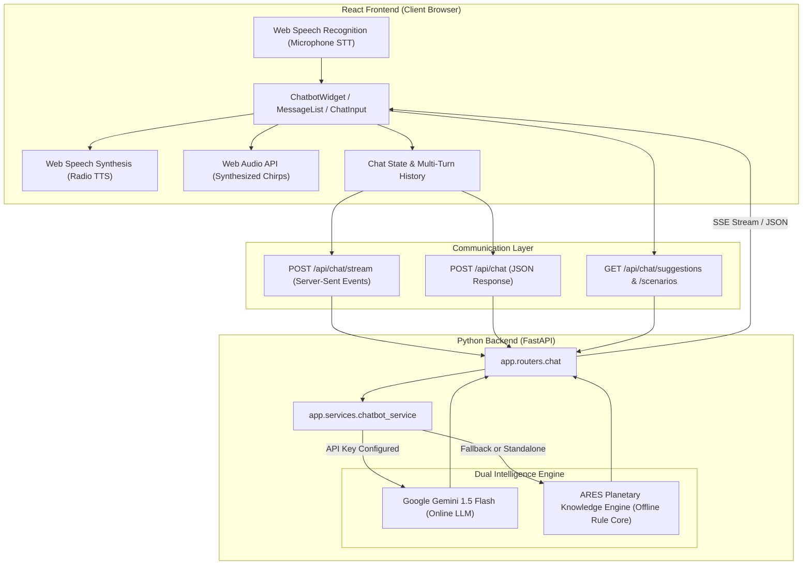

# 🤖 Mars Mind - ARES AI Chatbot Feature Documentation

> **NASA Space Apps Challenge 2026**  
> **Feature:** Onboard Autonomous Conversational AI Assistant (**ARES** — Autonomous Resource & Exploration Specialist)

---

## 1. 📖 Executive Overview

During deep-space and surface expeditions on Mars, astronauts face a **3 to 22-minute one-way light-time communication delay** with Earth Mission Control. A critical system anomaly or habitat inquiry cannot wait for an Earth-based response.

The **ARES AI Chatbot** is an onboard conversational agent designed to operate either **fully autonomously offline** or **augmented with large language models** (such as Google Gemini). It synthesizes real-time planetary meteorology, closed-loop life support (ECLSS), autonomous rover operations, and Deep Space Network (DSN) link budgets into an intuitive, responsive interface for crew members.

---

## 2. 🏛️ System Architecture & Data Flow



---

## 3. 🌟 Core Feature Capabilities

### 3.1 Dual-Engine Intelligence (Online + Resilient Offline)
- **Autonomous Core (Default):** Runs with zero external dependencies or API keys. Contains comprehensive scientific models for Martian surface pressure (612 Pa), gas mixtures ($CO_2$, $N_2$, $Ar$), MOXIE oxygen generation chemistry, Sabatier water recovery, and Deep Space Network orbital windows.
- **Gemini Live Engine:** When `AI_PROVIDER=gemini` and `AI_API_KEY` are provided in `backend/.env`, ARES streams live responses directly from Google's Gemini models while injecting real-time mission telemetry. If the network is interrupted or rates are exceeded, it automatically falls back to the local autonomous core.

### 3.2 Real-Time Telemetry Badges
Every response from ARES can embed live subsystem status badges directly inside the chat bubble:

| Subsystem | Metric Example | Status Level | Color Indicator |
|---|---|---|---|
| **ATMOSPHERE** | `Surface Pressure: 612 Pa` | `nominal` | Green |
| **ENVIRONMENT**| `Ambient Temp: -63°C` | `nominal` | Green |
| **ECLSS** | `Water Recovery: 98.2%` | `nominal` | Green |
| **MOXIE** | `O2 Output: 9.4 g/hr` | `nominal` | Green |
| **WEATHER** | `Dust Opacity (Tau): 2.85` | `warning` | Amber |
| **SAFETY** | `Airlock Pre-filter: Purge Active` | `alert` | Red |
| **COMMS** | `One-Way Delay: 12m 44s` | `nominal` | Green |

### 3.3 Interactive Mission Scenarios
The chatbot header features a **Mission Context Selector** allowing developers and astronauts to simulate different operational realities:

1. **Expedition Sol 142 - Nominal Operations:** Standard Martian summer in Jezero Crater.
2. **Regional Dust Storm (Tau > 2.8):** Simulates sudden atmospheric opacity increase, 72% solar panel power drop, and automated rover shelter parking.
3. **Solar Particle Event (SPE) Radiation Advisory:** Simulates high-energy cosmic flare alert with subterranean lava tube shelter lockdown.
4. **MOXIE Oxygen Electrolyzer Fluctuation:** Simulates cathode voltage variances in Module 2 with backup cryogenic reserve routing.

### 3.4 Real-Time Token Streaming (Server-Sent Events)
- Supports live token-by-token typewriter streaming via `/api/chat/stream`.
- Front-end displays a blinking mission cursor while streaming.
- Final SSE event packages telemetry badges, recommended actions, and suggestion chips in a single payload.
- Can be toggled on/off in the chat footer (`Live Stream (SSE)`).

### 3.5 Multimodal Voice & Audio Integration
- **Microphone Input (STT):** Astronauts can speak directly to ARES using browser speech recognition (`webkitSpeechRecognition`). Active listening is highlighted with an animated pulsing radar ring.
- **Audio Playback (TTS):** Responses feature an `🔊 Audio` button that reads messages aloud using the browser's Web Speech API with an authoritative robotic mission timbre.
- **Synthesized Radio Effects:** Transmission chirps, receive acknowledgments, and emergency alert tones are synthesized entirely in real-time via the browser's native **Web Audio API** (no external `.mp3` assets required). Can be muted via the footer audio toggle.

### 3.6 Action Recommendations & Follow-Up Chips
- **Interactive Action Prompts:** ARES attaches executable operational buttons (e.g. `⚡ Run Barometric Calibration`, `⚡ Test Storm Shelter Airlock Seal`).
- **Dynamic Suggestions:** Contextual follow-up chips prompt the user for the next logical telemetry check.

### 3.7 Mission Transcript Management
- **Search within Session:** Built-in filter input to instantly search transcripts in ongoing sessions.
- **One-Click Markdown Export:** Downloads the entire conversation history, including timestamps, telemetry badges, and sender roles, as a formatted `.md` log file.
- **Clear & Reset:** Resets conversation memory with a clean system greeting.

---

## 4. 🔌 API Specifications

### 4.1 `POST /api/chat`
Standard synchronous endpoint returning structured JSON.

#### Request Body
```json
{
  "message": "What is the atmospheric composition on Mars?",
  "history": [
    {
      "role": "user",
      "content": "Hello ARES",
      "timestamp": "2026-11-14T08:00:00Z"
    }
  ],
  "mission_context": "nominal"
}
```

#### Response Body (`200 OK`)
```json
{
  "reply": "**Martian Atmospheric Telemetry (Jezero Crater Station):**\n- **Gas Mixture:** 95.32% $CO_2$, 2.60% $N_2$, 1.90% $Ar$...",
  "source": "ARES (Autonomous Resource & Exploration Specialist) (Autonomous Core)",
  "timestamp": "2026-11-14T08:00:02Z",
  "suggestions": [
    "How does MOXIE produce breathable oxygen?",
    "What protection prevents habitat depressurization?",
    "Simulate a dust storm event"
  ],
  "telemetry": [
    {
      "label": "Surface Pressure",
      "value": "612 Pa",
      "status": "nominal",
      "subsystem": "ATMOSPHERE"
    },
    {
      "label": "Ambient Temp",
      "value": "-63°C",
      "status": "nominal",
      "subsystem": "ENVIRONMENT"
    }
  ],
  "actions": [
    {
      "label": "Run Barometric Calibration",
      "action_type": "diagnostic",
      "payload": { "sensor": "barometer_alpha" }
    }
  ]
}
```

---

### 4.2 `POST /api/chat/stream`
Server-Sent Events (SSE) endpoint providing real-time token streaming.

#### Streaming Format
- **Partial Chunk:**
  ```http
  data: {"chunk": "Martian ", "done": false, "source": "ARES (Autonomous Core)"}
  ```
- **Final Event:**
  ```http
  data: {"chunk": "", "done": true, "source": "ARES (Autonomous Core)", "suggestions": [...], "telemetry": [...], "actions": [...]}
  ```

---

### 4.3 `GET /api/chat/suggestions`
Returns a list of starter topics for new mission specialists.

---

### 4.4 `GET /api/chat/scenarios`
Returns the array of simulated mission scenarios with preset parameters.

---

## 5. 🧩 Frontend Component Breakdown

| Component | File Path | Responsibilities |
|---|---|---|
| **ChatbotWidget** | `frontend/src/components/Chatbot/ChatbotWidget.tsx` | Header, scenario selector, search bar, export markdown, clear log |
| **MessageList** | `frontend/src/components/Chatbot/MessageList.tsx` | Auto-scrolling viewport, empty-state starter cards, loading indicator |
| **MessageItem** | `frontend/src/components/Chatbot/MessageItem.tsx` | Formatted markdown bullets, callouts, copy button, TTS, telemetry badges, action prompts |
| **ChatInput** | `frontend/src/components/Chatbot/ChatInput.tsx` | Voice microphone STT, suggestion pills, enter-to-send, streaming toggle, mute toggle |
| **SoundManager** | `frontend/src/services/soundEffects.ts` | Web Audio API oscillator chirps, Web Speech API speech synthesis & recognition |
| **API Client** | `frontend/src/services/api.ts` | Typed `sendChatMessage`, `streamChatMessage`, `fetchScenarios`, `fetchHealth` |

---

## 6. ⚙️ Connecting External AI Providers (Google Gemini)

To connect ARES to Google Gemini:

1. Obtain an API key from [Google AI Studio](https://aistudio.google.com/).
2. Create or edit `backend/.env`:
   ```ini
   AI_PROVIDER=gemini
   AI_API_KEY=AIzaSy...your_actual_key...
   GEMINI_MODEL=gemini-1.5-flash
   ```
3. Restart the FastAPI server:
   ```bash
   uvicorn app.main:app --reload --host 127.0.0.1 --port 8000
   ```
4. ARES will now use Gemini 1.5 Flash for natural language queries while retaining telemetry badges, scenario awareness, and offline fallback.

---

## 7. 🧪 Testing & Verification

Run the automated chatbot verification suite from the repository root:

```bash
python backend/tests/verify_chatbot.py
```

Expected output:
```
Testing Mars Mind Chatbot Service...
Suggestions count: 6
Scenarios count: 4
Reply sample: **Martian Atmospheric Telemetry (Jezero Crater Station):**...
Source: ARES (Autonomous Resource & Exploration Specialist) (Autonomous Core)
Telemetry badges: ['Surface Pressure', 'Ambient Temp', 'CO2 Fraction']
Actions: ['Run Barometric Calibration', 'View Historical Sol Weather']
Dust storm scenario badge check: ['ARES Status', 'Mission Sol']
Streamed SSE events count: 50
ALL CHATBOT BACKEND TESTS PASSED SUCCESSFULLY!
```

